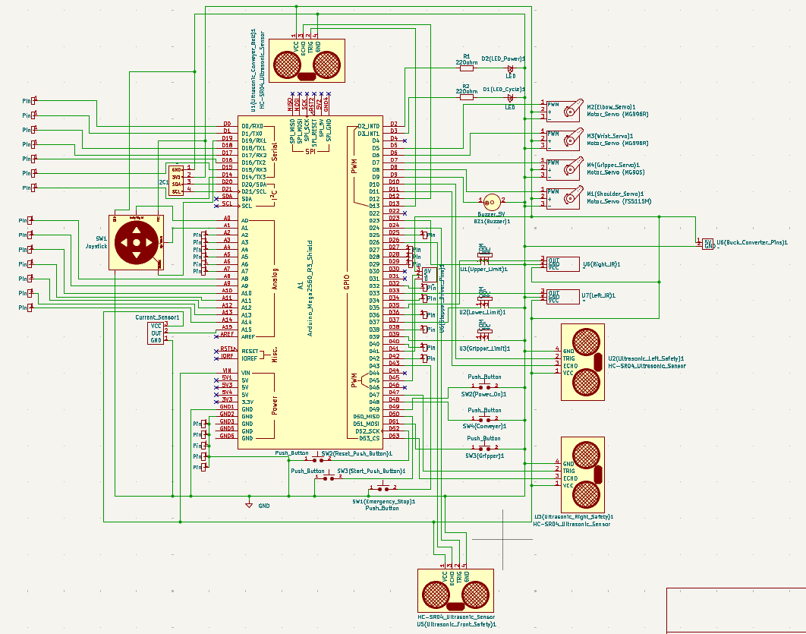

  <h1>Hi, I'm Rania Fares 👋</h1>
  <h3>1st Place Mechanical & Mechatronics Engineering (GPA: 4.43/4.50)</h3>
  
<em>🎓 Senior Engineering Student at UH-GAF (graduating July 2027) | Prospective Graduate Student</em>

  
  
  

 

- ⚙️ Integrating mechanical design, intelligent control, and robotics through electromechanical prototyping.
- 🧬 Biomimetic designs to engineer innovative solutions for complex medical and industrial challenges.
- 🎯 Actively seeking 2027 research-focused Master's programs in Robotics, Mechatronics, Systems & Control, and Neuroengineering.

  <h2>🚀 Mechatronics Engineering Projects</h2>

 

  <h3>🦾 Tactile-Integrated Hybrid Soft-Rigid Robotic Hand</h3>
  
<em>Ongoing Individual Thesis Research</em>

  
  
  
  
  

 

  

 

**What I'm doing:**
- Engineering a biomimetic soft-rigid manipulator intended for academic publication, specifically designed for safe, adaptive physical manipulation in dynamic, unstructured environments.
- Adapting the Yale OpenHand Model O (PF and PP) kinematics to design a novel control system that maximizes payload capacity and shape-conforming abilities for complex grasps.
- Innovating local manufacturing in Egypt to achieve a highly capable, budget-friendly prototype for under 5,000 EGP.
- Integrating tactile sensing arrays and servo actuators with an ESP32 microcontroller to close the real-time control loop.

  <h3>🚙 Vision-Guided Inverted-Tricycle Mobile Robot</h3>
  
<em>Ongoing Research with Active Suspension</em>

  
  
  
  

 

  

 

**What I did:**
- Co-authoring a research paper on a vision-based line-following robot, featuring a novel inverted "toktok" (auto-rickshaw) tricycle kinematic design with a rear caster wheel.
- Integrating a custom suspension system utilizing a leadscrew and DC motor mechanism to manage payload variations (1.5 to 3.0 kg) and reject external disturbances on various floor types (sand, water, oil) and slopes.
- Leading the programming and control systems architecture, utilizing MATLAB and embedded systems to process ESP32-CAM data and execute robust speed and trajectory tracking. 
- Managing comprehensive technical documentation for the research publication, detailing mathematical modeling, controller tuning, and real hardware validation.

  <h3>🔍 5-DOF Vision-Guided P4R Robotic Arm</h3>
  
<em>Assembly & Laboratory Automation (Ongoing)</em>

  
  
  
  

 

  

 

**What I did:**
- Developing a 5-DOF "P4R" (Prismatic-4-Revolute) robotic manipulator tailored for automated assembly and laboratory tube handling.
- Designed the physical architecture by mounting a 4-DOF servo-driven articulated arm onto a DC motor linear slide, creating a redundant degree of freedom that expands the X-axis reachable workspace to 600 mm for dynamic lab setups.
- Formulated the robot's Forward Kinematics using standard Denavit-Hartenberg (DH) parameters and implemented numerical Inverse Kinematics utilizing the Damped Least Squares (Levenberg-Marquardt) algorithm to stabilize joint updates near kinematic singularities.
- Integrated an ESP32-CAM vision system utilizing OpenCV to perform object detection, pose estimation, and precise part alignment, enabling advanced vision-guided assembly and automated repetitive laboratory tasks like sample handling.

  <h3>🏆 Autonomous Robotic Palletizer (NexUS)</h3>
  
<em>1st Place Overall & 1st Place Technical Documentation</em>

  
  
  
  

 

  
  

 

**What I did:**
- Engineered a 4-DOF P3R SCARA robotic palletizer for tabletop manufacturing under strict spatial and budget constraints.
- Developed a C++ Finite State Machine (FSM) on an Arduino Mega for deterministic multi-axis trajectory control.
- Dampened operational vibrations using a 7mm CNC-machined MDF base and 3D-printed PLA+ linkages, validated via FEA.
- Simulated the manipulator’s kinematic workspace to optimize joint movements prior to physical fabrication.
- Led hardware integration and technical documentation, securing 1st Place Overall and 1st Place Technical Documentation.

  <h3>🎮 Multi-Mode Arcade Console & Electronics Tester</h3>
  
<em>Hardware Prototyping & Embedded Systems</em>

  
  
  

 

  

 

**What I did:**
- Engineered the "Pixel Pioneers" custom arcade console featuring single and two-player game modes including Memory Race, Coordination Test, and Fastest Reaction[cite: 195, 200, 216]. 
- Programmed the game logic in Embedded C using an Arduino Mega 2560, integrating a 20x4 I2C LCD for user feedback, push buttons, and non-blocking `millis()` interval checks for strict time-sensitive gameplay[cite: 202, 203, 208, 215].
- Modeled the ergonomic physical structure and component layout of the arcade console in CATIA V5 prior to physical assembly[cite: 220].
- Designed a single-axis vibration platform ("Electronic Shaking Table") aligned with ISO standards in CATIA V5 for rigorous electronics testing.
- Designed and validated a functional mini-hydraulic scissor lift hoist prototype utilizing PLA tracks and engineering drawing packages.

  <h3>🧮 Computational Engineering Mathematics & Bio-Signal Simulations</h3>
  
  
  
  
  

 

**What I did:**
- 🧠 **Cognitive Fatigue Stats:** Built vectorized algorithms for IQR outlier detection and bivariate correlation to analyze sleep/stress impacts on Psychomotor Vigilance Task (PVT) reaction times.
- 🫀 **ECG Fourier Analysis:** Decomposed and reconstructed cardiac bio-signals, evaluating harmonic convergence and the Gibbs Phenomenon in high-frequency transients.
- ⚙️ **Dynamic Systems:** Solved coupled damped harmonic oscillators ("Digital Spirographs"), benchmarking exact symbolic Laplace Transform derivations against numerical `ode45` solvers.
- ⚡ **Neural Modeling:** Simulated Leaky Integrate-and-Fire (LIF) potentials and mapped cortical activation centers, validating the superior accuracy of Runge-Kutta 4 (RK4) over Euler's method.

  <h2>🛠️ Technical Skills</h2>

  <strong>CAD, FEA & CFD:</strong> 
   &nbsp;
   &nbsp;
   &nbsp;
  

 

  <strong>Programming & Software:</strong> 
   &nbsp;
   &nbsp;
   &nbsp;
   &nbsp;
   &nbsp;
   &nbsp;
  

 

  <strong>Electronics & Microcontrollers:</strong> 
   &nbsp;
   &nbsp;
   &nbsp;
   &nbsp;
  

 

  <strong>Hardware & Simulation Components:</strong> 
   &nbsp;
   &nbsp;
   &nbsp;
   &nbsp;
   &nbsp;
   &nbsp;
  

 

  <strong>Robotics & Control:</strong> 
   &nbsp;
   &nbsp;
   &nbsp;
   &nbsp;
  

 

  <strong>Manufacturing & Prototyping:</strong> 
   &nbsp;
   &nbsp;
   &nbsp;
   &nbsp;
   &nbsp;
   &nbsp;
  

  <h2>🔬 Research & Professional Experience</h2>

🏆 **1st Place Academic Paper** | 
> Authored a literature review on the cognitive impacts of AI pedagogical agents in digital education.

🏭 **Supply Chain Material Handling Intern** | 
> Led an intern team to execute GMOS time studies, validate 20% of Optra component process data, and map material flow logic.

⚡ **Electrical Design Engineering Intern** | 
> Traced signal flows across distributed bus electrical systems and diagnosed ECU logic gate faults.

 

  <strong>🏅 Professional Certifications:</strong>  
   &nbsp;
  

 

  <i>Seeking opportunities to push the boundaries of mechatronic systems and biomimetic robotics.</i>

